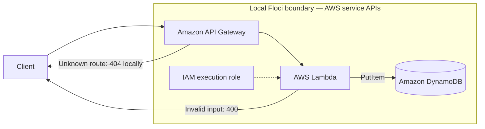

# Lab 01 architecture and observed behavior

## What this lab verifies

- OpenTofu provisions the REST API, Lambda, IAM role/policy, and DynamoDB table against Floci.
- API Gateway invokes the Lambda for `POST /notes`.
- Lambda validates input and writes a generated ID and note to DynamoDB.

## Compatibility notes

- **Validated with Floci 2.0.1 and `hashicorp/aws` 6.64.0.** The REST API, Lambda, IAM resources, and DynamoDB table apply successfully.
- Floci reports API Gateway integration `timeoutInMillis` as `0` and rejects the AWS provider's corresponding update patch. The configuration uses the provider's minimum valid value and ignores this emulator-only field so a repeat apply does not fail. Do not copy that lifecycle rule to AWS-targeted infrastructure without re-evaluating it.
- The local `plan` and `deploy` commands first refresh existing state, then normalize only the ignored API Gateway timeout to the provider's minimum. The immediately following plan/apply skips a second refresh so it does not reintroduce that emulator value. This detects resources lost after a Floci restart while allowing configuration updates. See the root README for the local-state compatibility boundary; use normal refresh in an AWS-backed validation job.
- The first Lambda invocation pulls `public.ecr.aws/lambda/nodejs:22`; subsequent invocations use the warm local container.
- Floci is an AWS-compatible emulator, not a substitute for production AWS validation; IAM enforcement, service latency, quotas, and API Gateway edge behavior must be verified in an AWS sandbox before release.
