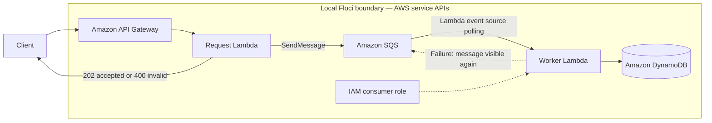

# Lab 02 architecture

## Architectural intent

The API’s responsibility ends after durable queue acceptance, which decouples request latency from processing. The worker must make writes idempotent by using the job ID as the DynamoDB primary key. Lab 03 will add retry, visibility timeout, and DLQ behavior; Lab 02 focuses only on the happy asynchronous handoff and input validation.

## Floci compatibility notes

- Lambda containers must use `localhost.floci.io` rather than `localhost` when calling an SQS QueueUrl. The latter refers to the Lambda container, not the Floci service. The request handler normalizes the locally returned QueueUrl accordingly.
- As in Lab 01, API Gateway integration timeout refresh is an emulator/provider mismatch. The shared local workflow refreshes existing state, normalizes only that ignored local field, and skips the second refresh immediately before planning or applying.
