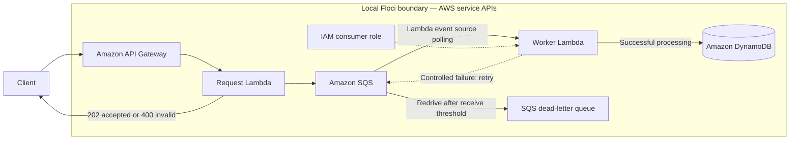

# Lab 03 architecture

The queue has a 60-second visibility timeout, six times the worker's 10-second timeout, and `maxReceiveCount` of two. The bounded integration poll allows time for visibility expiration and redrive. The worker’s controlled failure is intentional: it verifies redrive behavior without relying on an intermittent dependency. In production, make consumers idempotent because a message may be delivered more than once.

Floci Lambda containers need `localhost.floci.io` for a queue URL returned as `localhost`; the request Lambda normalizes that host. API Gateway timeout state is reconciled by the shared local workflow before planning or applying.
