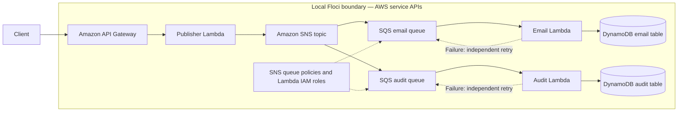

# Lab 04 architecture

SNS fan-out isolates consumers: each queue retains and retries its own delivery without blocking the other. The topic subscriptions request raw message delivery so each worker receives the original notification JSON directly, rather than an SNS envelope.

Verified on Floci 2.0.1 with AWS provider 6.64.0: deployment and the integration
test pass, including persistence by both independent consumers.

As with the preceding API Gateway labs, the local workflow reconciles Floci’s API Gateway timeout state before applying. IAM and queue policies are included so the infrastructure shape remains meaningful when moved to AWS.
