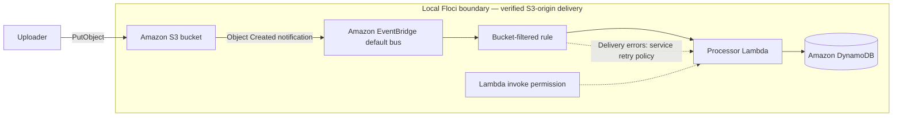

# Lab 05 architecture and validation boundary

## Intended AWS behavior

`aws_s3_bucket_notification` enables EventBridge delivery for the bucket. AWS emits S3 Object Created events on the default bus; the rule limits delivery to this bucket and invokes the processor Lambda.

## What the local integration test proves

The integration test uploads a real S3 object and polls DynamoDB for its bucket and generated key, then deletes the uploaded object. This passed against Floci 2.0.1 with AWS provider 6.64.0. No synthetic `PutEvents` injection is used.

## Observed local behavior

- OpenTofu deployed all nine resources, including the bucket EventBridge notification configuration.
- A signed local `PutObject` caused an EventBridge event and Lambda invocation, producing the matching DynamoDB record.
- DynamoDB requests must use `application/x-amz-json-1.0`; the previous test used the EventBridge JSON 1.1 content type and received `UnknownOperationException`.

Production release still requires an AWS-sandbox test that uploads an object, waits for the DynamoDB row, and verifies least-privilege IAM (the local emulator does not provide sufficient IAM-enforcement coverage).
