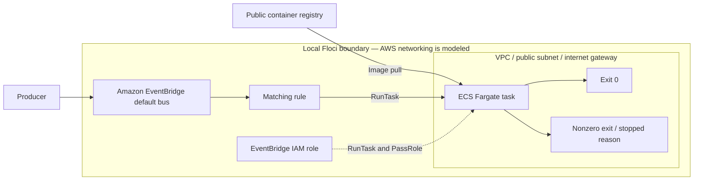

# Lab 06 architecture and validation boundary



## Intended AWS behavior

An event whose source is `lab.architecture` and detail type is `run-task` matches the EventBridge rule. EventBridge assumes the narrowly scoped role and calls `ecs:RunTask` for the Fargate-compatible task definition. The task runs in the lab VPC public subnet with public IP assignment and an internet gateway route for public image pulls, writes its startup marker, and exits successfully.

## Local test contract

The integration test publishes a matching EventBridge event and polls ECS for a stopped task. To pass, it must confirm an event was accepted, a new task was created, the expected task family reached `STOPPED`, and its container exited with code zero. It does not claim that Floci reproduces AWS networking, Fargate scheduling, image-pull behavior, CloudWatch logging, or IAM enforcement.

## Observed behavior — Floci 2.0.1, 2026-09-12

`make deploy LAB=06-eventbridge-ecs-task` created all 14 resources, including the VPC, subnet, internet gateway, default route, security group, roles, task definition, and EventBridge ECS target.

`make test LAB=06-eventbridge-ecs-task` accepted the event with zero failed entries, then failed after 30 seconds because no stopped task appeared. The emulator logged:

```text
EventBridge: unsupported target ARN type: arn:aws:ecs:us-east-1:000000000000:cluster/lab06-scheduled-task-cluster
```

The missing boundary is EventBridge target dispatch; accepting the target configuration does not demonstrate invocation support. Image pulling and ECS exit-status reporting were not reached by this test. The native architecture and strict test are retained, so this unsupported integration remains visible as a failure. A direct `RunTask` call would not establish EventBridge delivery. AWS execution has not been tested.
