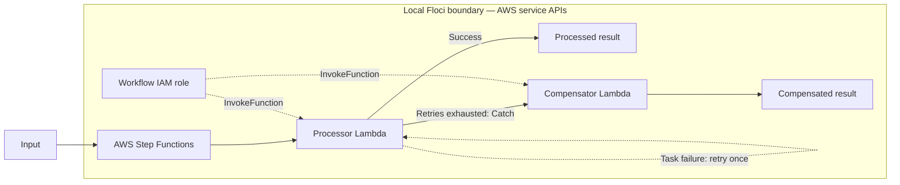

# Lab 07 architecture notes

The retry is deliberately short: one second and `MaxAttempts = 1`, meaning one retry after the initial invocation, or two total attempts. Production workflows should set retry classes, intervals, and maximum attempts from the downstream service's idempotency and recovery guarantees.

Deployment and integration tests passed on Floci 2.0.1 with AWS provider 6.64.0. The test uses Step Functions' `StartExecution` and `DescribeExecution` APIs to verify both happy and compensation branches. It also reads paginated `GetExecutionHistory` and asserts exactly two processor `TaskScheduled` events for the forced failure, establishing one initial invocation plus one retry before compensation. These observations cover the local `lambda:invoke` integration; IAM enforcement and production failure modes still require validation in an AWS sandbox.
