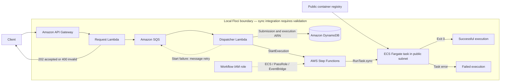

# Lab 08 architecture notes

The API boundary ends at the SQS acknowledgement. The dispatcher stores the Step Functions execution ARN before acknowledging its SQS delivery. The workflow waits for the Fargate task through `ecs:runTask.sync`. A later task failure belongs to the workflow and does not redeliver the already acknowledged SQS message; a dispatcher failure to start or record the execution allows SQS redelivery. The database's `submitted` record is correlation metadata, not proof of task completion.

The supplied task intentionally uses a minimal public Alpine image and a bounded one-second command. It proves orchestration rather than business-container logic. Replace it with an application image and explicit task-level observability for a production workload.

The task uses an `awsvpc` network configuration with public IP assignment, an internet gateway route, and outbound HTTPS for pulling its public image. These resources model AWS connectivity; Floci's Docker runtime does not prove the network path or IAM enforcement.

The integration contract requires acceptance, durable correlation, and a successful terminal workflow plus a stopped ECS task with exit code zero. A submission-only result cannot pass that contract. All these assertions passed on Floci 2.0.1 with AWS provider 6.64.0, along with 400/404 negatives. The ECS test requests use JSON protocol 1.1; DynamoDB and Step Functions requests use 1.0. This confirms local execution, not AWS networking or IAM enforcement.
