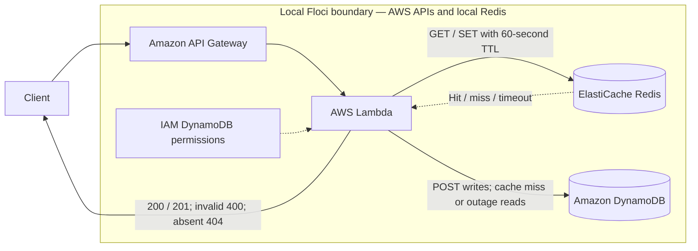

# Lab 09 architecture

The test verifies both the database fallback and cache-hit path. In Floci, a single-node replication group reports its usable endpoint through `configuration_endpoint_address`; the lab uses that endpoint instead of AWS's nullable `primary_endpoint_address`.

Verified on 2026-09-12 against Floci 2.0.1 and AWS provider 6.64.0: deployment recreated resources absent after the earlier memory-mode reset; the updated integration test passed with a large Unicode note, full database/cache value equality, absent-note `404`, and malformed/blank-input `400`. A subsequent refreshed plan reported no changes. All six Redis regression tests passed. Cache outages are covered by mocked failures in those unit tests; the live integration does not shut down Redis.

Lambda owns both reads: Redis never calls DynamoDB. A missing or malformed cache entry, Redis server error, connection failure, or two-second command deadline falls back to a consistent DynamoDB read. A failed cache fill does not discard the database result; database errors remain errors. The small RESP2 client buffers bytes until the entire scalar frame arrives, limits replies to 1 MiB, and closes sockets on success or failure. It supports only GET/SET replies used by this lab, not general Redis operations or authenticated/TLS deployments.

Run `node --test labs/09-redis-cache-aside/tests/unit/redis.test.mjs` for parser, fragmented socket, premature close, deadline, and cache-outage regression coverage. Production AWS deployments also require Lambda VPC access and Redis security-group/TLS/authentication configuration appropriate to the environment; the local endpoint does not establish those properties.
