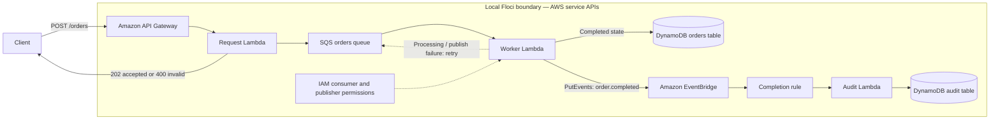

# Lab 10 architecture and validation boundary

## Intended behavior

The request function validates a customer ID and positive order quantity before returning `202` and enqueueing the order. The worker is the state-transition owner: it writes `completed` to the orders table and then emits `order.completed`. The audit consumer is intentionally decoupled; it writes a separate audit record keyed by the order ID.

## What the integration test proves

The test submits an order through API Gateway, then polls both DynamoDB tables until the worker's state record and the audit consumer's event record exist for that exact ID. This is an end-to-end local test of all five hops, with bounded polling rather than a fixed delay.

Verified on Floci 2.0.1 with AWS provider 6.64.0: deployment and the end-to-end
test pass, including the correlated order/audit records and 400/404 negatives.

## Delivery semantics and production follow-up

The worker can be retried after a successful DynamoDB write but before a successful EventBridge response. Both tables use a stable order key, making repeated writes idempotent, but downstream side effects still require an idempotency strategy in a production system. Floci is not evidence of AWS IAM enforcement, retry timing, Lambda event-source failure behavior, or EventBridge delivery guarantees. Validate those properties with AWS sandbox tests, a DLQ policy, and operational alarms before release.
